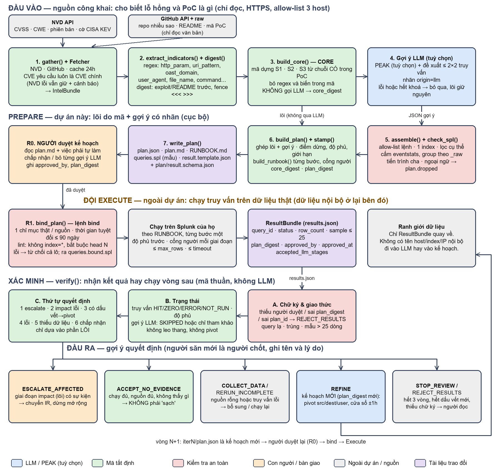
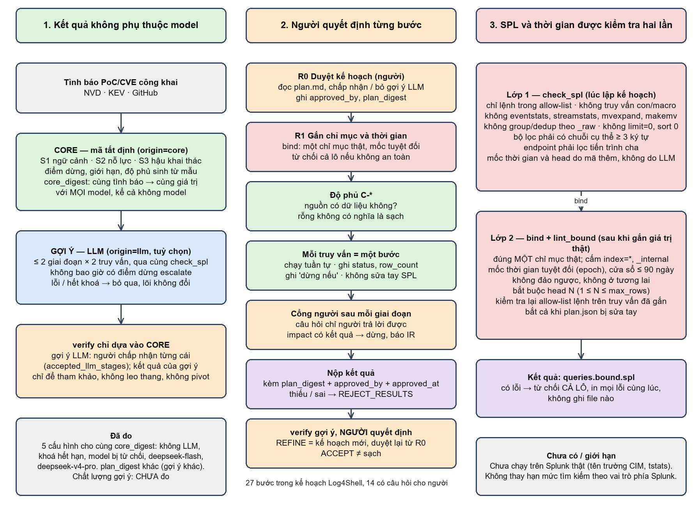

# AI Agent Hunting (v7) — PEAK Assistant + hunt tất định + khuyến nghị cho người quyết định

Công cụ hỗ trợ săn mối đe dọa theo khung PEAK. Phần **Prepare** do
[PEAK Assistant](https://github.com/Cisco-Talos/PEAK-Assistant) (Cisco Talos) đảm nhiệm, phần **Execute**
chạy các predicate literal trên telemetry, phần **Act** đưa ra *khuyến nghị có xếp hạng* để người săn
mối đe dọa quyết định. Hệ thống không tự hành động.

```text
PoC (JSON) ──► PEAK Assistant: ABLE table + hunt plan (planner/critic)      [LLM, tham khảo]
          ──► Execute: predicate field/op/value trên CDB (SQLite)           [tất định, không LLM]
          ──► Judge + Advisor (LLM) + luật tất định                          [tham khảo]
          ──► recommendation.md / .json  → NGƯỜI QUYẾT ĐỊNH
```

Bất biến: LLM không tạo hay sửa bằng chứng; bản ghi chỉ đến từ adapter. Kết quả rỗng khi nguồn telemetry
không có dữ liệu được báo là `COLLECT_DATA_THEN_RERUN`, không phải "sạch".

## Hướng mới: Prepare-only từ PoC công khai

Dự án chỉ làm đúng chữ **P** (Prepare) của khung PEAK. Đầu vào là PoC công khai (CVE, repo GitHub nhiều sao). Đầu ra là
**kế hoạch săn**: giả sử PoC này được dùng để tấn công, các giai đoạn tấn công, dấu vết mỗi giai đoạn, truy vấn SPL chỉ đọc, giới hạn
và điểm dừng. Đội Execute chạy kế hoạch trên dữ liệu của họ; sau đó `verify` quyết định chấp nhận kết quả hay sinh vòng pivot tiếp theo.
Không đụng hệ thống nội bộ, không chạy PoC.



### Vai trò từng phần

| Phần (hàm chính) | Vai trò | Dùng LLM? |
|---|---|---|
| **Nguồn công khai** (NVD, GitHub) | Cho biết lỗ hổng là gì (CVSS, phiên bản, có bị khai thác ngoài thực tế không) và PoC làm gì. Chỉ đọc văn bản, qua 3 host cố định. | Không |
| **1. `gather()` + `Fetcher`** | Thu thập tình báo, có cache; chọn repo theo số sao, bỏ fork, file nhị phân và file nhiễu. | Không |
| **2. `extract_indicators()` + `digest()`** | Trích tất định các dấu vết (tham số HTTP, chuỗi payload, tên miền out-of-band, tên file...) và gói văn bản cho LLM. Danh sách này dùng để đối chiếu, nhằm không để LLM bịa. | Không |
| **3. `build_core()`** (`plan/core.py`) | **Dựng phần lõi của kế hoạch bằng mã**: giai đoạn S1 ngữ cảnh, S2 nỗ lực khai thác, S3 hậu khai thác; truy vấn chỉ từ chuỗi có trong PoC/CVE, bỏ regex và biến trong mã; truy vấn tiến trình chỉ khi suy ra được tiến trình cha từ tên sản phẩm. Cùng tình báo thì cùng `core_digest`, dù dùng model nào. | Không |
| **4. Gợi ý LLM** (`run_peak_texts()` tuỳ chọn + `_suggest()`) | PEAK viết bảng ABLE/kế hoạch làm ngữ cảnh; LLM đề xuất tối đa 2 giai đoạn × 2 truy vấn **bổ sung** (nhãn `origin=llm`). PoC là dữ liệu không tin cậy. Lỗi hoặc hết khoá thì bỏ qua, lõi không đổi. | Có (tuỳ chọn) |
| **5. `assemble()` + `check_spl()`** | Chốt chặn an toàn: chỉ cho truy vấn chỉ đọc trong danh sách lệnh cho phép, tự gắn cửa sổ thời gian và trần dòng; truy vấn process trên endpoint buộc phải lọc theo tiến trình cha (không thì `whoami` của quản trị viên cũng khớp); chữ lẫn ngôn ngữ khác bị yêu cầu viết lại; truy vấn sai bị gửi lại để sửa (tối đa 3 lượt), vẫn sai thì loại. | Không |
| **6. `build_plan()` + `stamp()`** | Ghép lõi và gợi ý; điểm dừng theo mức ý nghĩa của giai đoạn, truy vấn kiểm tra độ phủ nguồn, giới hạn, nhãn xuất xứ; sinh `RUNBOOK.md` từng bước; tính `core_digest` và `plan_digest`. LLM không quyết định các thứ này. | Không |
| **7. `write_plan()`** | Ghi `plan.json`, `plan.md`, `RUNBOOK.md`, `queries.spl` (mẫu), `result.template.json` và schema, tức là các tài liệu bàn giao. | Không |
| **R0. Người duyệt kế hoạch** | Đọc `plan.md`, chấp nhận hoặc bỏ từng gợi ý LLM, ghi tên người duyệt. Bộ kiểm tra chỉ bảo đảm an toàn và hình thức, không bảo đảm truy vấn bắt đúng tấn công. | |
| **`bind` rồi đội Execute** (ngoài dự án) | `main.py bind` gắn chỉ mục thật và mốc thời gian tuyệt đối, từ chối truy vấn không an toàn; đội Execute chạy theo `RUNBOOK.md` trên Splunk của họ rồi trả `ResultBundle` kèm `plan_digest` và người duyệt. Dữ liệu nội bộ ở lại bên họ. | |
| **`verify()`** | Kiểm tra chữ ký (`plan_digest`, người duyệt) và giao thức, tính trạng thái từng truy vấn, độ phủ và từng giai đoạn, rồi chọn quyết định theo thứ tự ưu tiên; chỉ phần lõi quyết định. | Không |
| **Quyết định** | `ESCALATE_AFFECTED` (chuyển IR), `ACCEPT_NO_EVIDENCE` (không phải "sạch"), `COLLECT_DATA`/`RERUN_INCOMPLETE`, `REFINE` (vòng pivot N+1, cửa sổ ±1 giờ), `STOP_REVIEW`/`REJECT_RESULTS`. Chỉ hỗ trợ; người săn chốt. | |

Vòng lặp dừng khi chuyển IR, chấp nhận, hết 3 vòng, hoặc không còn giá trị mới để pivot.

### Lệnh

```bash
python main.py plan --cve CVE-2021-44228 --min-stars 500 --no-peak   # LLM trong .env là tuỳ chọn; --no-peak bỏ PEAK (nhanh, ít token)
python main.py plan --cve CVE-2021-44228 --min-stars 500 --offline   # chỉ phần lõi, không gọi LLM
python main.py bind --plan <thư mục>/iter1/plan.json --map web=<index> --map dns=<index> ... --earliest ISO --latest ISO
python main.py verify --plan artifacts/plans/CVE-2021-44228/iter1/plan.json --results results.json
python main.py schema --out schemas/                           # JSON Schema của HuntPlan và ResultBundle
```

Chi tiết, hợp đồng dữ liệu, mô hình an toàn và giới hạn: [`docs/PREPARE-WORKFLOW.md`](docs/PREPARE-WORKFLOW.md). Pipeline
Prepare→Execute→Act bên dưới vẫn còn, dùng làm bộ thử cục bộ trên dữ liệu BOTS v1 công khai.

## Kết quả chạy thử v0.4 và đối chiếu 3 tiêu chí

Chạy thật với Log4Shell (CVE-2021-44228), `deepseek-flash`, không PEAK (`--no-peak`): 2 lời gọi LLM, 16.839 token. Kết quả đọc ngay tại
[`results/prepare-log4shell-v04/`](results/prepare-log4shell-v04/): [`plan.md`](results/prepare-log4shell-v04/plan.md) (kế hoạch cho người đọc),
[`RUNBOOK.md`](results/prepare-log4shell-v04/RUNBOOK.md) (quy trình từng bước), [`plan.json`](results/prepare-log4shell-v04/plan.json) (bản máy đọc).



**Kế hoạch gồm những gì**

| Phần | Nội dung | Ai tạo |
|---|---|---|
| S1 ngữ cảnh | 2 truy vấn: User-Agent của công cụ quét, đường dẫn trong PoC | mã (`core`) |
| S2 nỗ lực khai thác | 1 truy vấn: chuỗi payload `${jndi:...}` và biến thể che giấu | mã (`core`) |
| S3 hậu khai thác | 5 truy vấn: DNS và proxy tới tên miền out-of-band, tệp do PoC tạo (web và endpoint), tiến trình con bất thường của dịch vụ Java (có lọc tiến trình cha) | mã (`core`) |
| L1, L2 gợi ý | 4 truy vấn: JNDI trong log ứng dụng, `JndiLookup`, kết nối cổng 1389/1099, tải tệp `.class` qua proxy | LLM, có nhãn, người chấp nhận từng cái |
| Độ phủ | 6 truy vấn `tstats` kiểm tra nguồn có dữ liệu không (rỗng không có nghĩa là sạch) | mã |
| Quy trình | 27 bước `R0..R26` (8 bước tuỳ chọn cho gợi ý LLM), 14 bước có câu hỏi chỉ người trả lời được (5 cổng cuối giai đoạn) | mã |

**Kiến trúc để đạt các mục tiêu**

```
PoC/CVE công khai ─► gather ─┬─► CORE (mã, tất định) ──────┐
                             └─► LLM (tuỳ chọn) ─► gợi ý ───┴─► kế hoạch + RUNBOOK + core_digest/plan_digest
   NGƯỜI duyệt (R0) ─► bind (chỉ mục thật + mốc thời gian tuyệt đối, lint lần 2) ─► queries.bound.spl
   Đội Execute chạy tuần tự, mỗi giai đoạn có cổng người ─► results.json (kèm plan_digest + người duyệt)
   verify (không LLM): ACCEPT / ESCALATE / REFINE / COLLECT_DATA ... ─► NGƯỜI quyết định cuối
```

**Đã đáp ứng 3 tiêu chí chưa?** Trả lời thẳng: đáp ứng ở mức thiết kế và kiểm tra tự động, chưa đáp ứng ở mức thực chiến.

| Tiêu chí | Đáp ứng | Bằng chứng | Chưa có / giới hạn |
|---|---|---|---|
| 1. Không phụ thuộc model | **Một phần.** Phần quyết định thì có; chất lượng gợi ý thì không | Cùng `core_digest` `ab80eec6…` ở 5 cấu hình thật: không LLM, khoá hết hạn (401), model bị từ chối (404), và hai lần chạy LLM thật `deepseek-flash`, `deepseek-v4-pro`; hai lần sau chỉ `plan_digest` khác vì gợi ý khác (4 so với 2 truy vấn). Test tự động: 5 model giả lập cho cùng lõi và cùng quyết định `verify` | "Hiệu quả tương đương" **chưa đúng** với gợi ý: model mạnh/yếu cho gợi ý khác nhau, chất lượng chưa đo. Mới thử 1 CVE, 2 model cùng hãng. Lõi hẹp: chỉ tìm chuỗi có trong PoC |
| 2. Người quyết định từng bước | **Có ở mức cơ chế** | Runbook 27 bước, mỗi truy vấn một bước kèm "ghi lại" và "dừng nếu"; kết quả thiếu người duyệt hoặc sai `plan_digest` bị `REJECT_RESULTS` (thử 2 kịch bản); `verify` chỉ gợi ý, luôn `human_required` | Chưa có đội Execute và người thật chạy theo runbook. Cổng duyệt chỉ kiểm được tên người và digest, không kiểm được họ có đọc |
| 3. SPL an toàn, đúng ngày giờ | **Có ở mức kiểm tra tĩnh** | `bind` từ chối `index=*`, `_internal`, thiếu ánh xạ, cửa sổ 200 ngày, cửa sổ tương lai (5/5 bị chặn, không ghi file); mốc thời gian luôn là epoch tuyệt đối, tối đa 90 ngày; bắt buộc `head N`; cấm `eventstats`/`streamstats`/`mvexpand`, group theo `_raw`, `limit=0`. 18 truy vấn của kế hoạch này qua `lint_bound` | **Chưa chạy trên Splunk thật**: tên trường CIM, `tstats`, tải thực tế chưa kiểm. Không thay được hạn mức tìm kiếm theo vai trò phía Splunk |

Kiểm thử: 189 test pass. Kế hoạch bằng `--offline` (không LLM) chạy được toàn bộ; xem [`docs/PREPARE-WORKFLOW.md`](docs/PREPARE-WORKFLOW.md) mục 5b.

## Cài đặt (Python ≥ 3.12)

```bash
python -m venv .venv
.venv\Scripts\activate          # Windows;  source .venv/bin/activate trên Linux/macOS
pip install -e ".[dev]"          # lõi tất định, KHÔNG cần LLM
pip install -e ".[peak]"         # tuỳ chọn: PEAK Assistant (pin theo commit) cho pha Prepare
cp .env.example .env             # tuỳ chọn: điền LLM_ENDPOINT, LLM_API_KEY, LLM_MODEL (endpoint tương thích OpenAI)
```

LLM là tuỳ chọn: chưa cài extra `peak` hoặc chưa điền `.env` thì hệ thống tự chạy phần tất định và đưa khuyến nghị
theo luật (in một dòng `[i]`). `--model NAME` ghi đè `LLM_MODEL` (ví dụ mô hình `:free` của OpenRouter).

Luận văn/đồ án đầy đủ (lý thuyết, thiết kế, hướng dẫn thực hành, thực nghiệm, phụ lục): `docs/thesis/`
(`LUAN-VAN-AI-AGENT-HUNTING.docx` / `.pdf`; dựng lại bằng `python docs/thesis/build_thesis.py`).

## Chạy

```bash
# Tất cả PoC trong pocs/ (PEAK Assistant + LLM; mỗi PoC ~4-8 phút vì planner/critic lặp)
python main.py --poc-dir pocs --db data/botsv1_eval.sqlite

# Một PoC, cửa sổ tự chọn
python main.py --poc pocs/poc-joomla-rce.json --window 2016-08-10T21:36:00Z/2016-08-10T22:00:00Z

# Chỉ phần tất định (không PEAK, không LLM)
python main.py --poc-dir pocs --offline

# Dữ liệu nhạy cảm + LLM từ xa: che host/user/IP trong mọi thứ gửi cho judge/advisor
python main.py --poc-dir pocs --redact
```

Vận hành LLM (đều tuỳ chọn):

| Cờ / biến | Tác dụng |
|---|---|
| `--judge-votes N` (mặc định 3) | judge gọi N lần, lấy đa số; độ tin cậy = thấp nhất trong nhóm đa số; không đa số thì không có judgment |
| `--redact` | che host/user/IP (và mọi IPv4) trước khi gửi, khôi phục trong báo cáo; xem giới hạn ở `src/hunting/redact.py` |
| `--token-budget N` | tối đa N token mỗi PoC (mọi agent kể cả trong PEAK); chạm trần thì các lời gọi sau bị từ chối, không retry |
| `--cache-dir DIR` / `--no-cache` / `--refresh-prepare` | cache kết quả PEAK Prepare theo (PoC, mô tả dữ liệu, model, phiên bản PEAK): chạy lại cùng PoC là tức thì và cho đúng cùng ABLE/kế hoạch |
| `LLM_MODEL_FALLBACKS`, `LLM_TEMPERATURE`, `LLM_MIN_INTERVAL` | model dự phòng, temperature cho judge/advisor (mặc định 0), giãn cách giữa các lời gọi |

Báo cáo ghi model thực sự trả lời (khác `auto`), token của mọi agent (kể cả PEAK), số lần chuyển model dự phòng và trạng thái cache.

Kết quả nằm ở `artifacts/runs/<thời gian>/`: `summary.md`, và mỗi PoC có `recommendation.md`,
`recommendation.json`, `peak_able.md`, `peak_hunt_plan.md`, ledger, bản nháp SPL (`act/`).
Mẫu kết quả đã kiểm chứng: [`results/`](results/).

## Kiểm thử

```bash
python -m pytest tests -q
ruff check .
```

## Cấu trúc

| Đường dẫn | Vai trò |
|---|---|
| `src/hunting/llm.py` | `.env` → cấu hình `model_config.json` của PEAK; caller đồng bộ dùng chung client PEAK |
| `src/hunting/prepare.py` | cầu nối PEAK: `able_table`, `plan_hunt` (tuỳ chọn `researcher`); có fallback offline |
| `src/hunting/poc/` | mô hình PoC, loader JSON, agent thực thi, judge |
| `src/hunting/adapters/` | adapter CDB (SQLite); `source_presence`, `describe_data`. Adapter Splunk live chỉ còn trong lịch sử git (commit `4dace56`) |
| `src/hunting/recommend.py` | luật khuyến nghị + advisor |
| `src/hunting/pipeline.py`, `cli.py`, `report.py` | điều phối, CLI, báo cáo |
| `pocs/` | PoC mẫu (BOTS v1) |
| `docs/ARCHITECTURE.md`, `docs/BAO-CAO-PEAK-ASSISTANT.md` | kiến trúc, luật khuyến nghị, giới hạn; báo cáo thay đổi và kết quả |
| `src/hunting/intel/`, `src/hunting/plan/`, `plan_cli.py` | hướng Prepare-only: tình báo công khai → `HuntPlan` → `verify` (xem mục đầu và `docs/PREPARE-WORKFLOW.md`) |
| (lịch sử git) | engine v6 (ClaimGraph) và tài liệu cũ nằm trong lịch sử git: `git checkout v6-engine-final` (commit `9d49fe1`, có trong lịch sử nhánh `huy`) |
